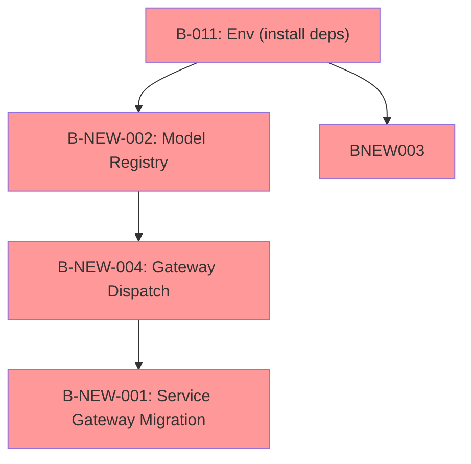

# HYDROMA ARCHITECTURE GAP ANALYSIS

**Generated**: 2026-10-09  
**Method**: Source code inspection + runtime import tests + invariant scanning  
**Purpose**: Compare current architecture against the target architecture defined in HYDROMA-MASTER.md and quantify gaps across 8 architectural dimensions.

---

## 1. Target Architecture (from HYDROMA-MASTER.md)

The target architecture is a **layered hexagonal** design:

```
┌─────────────────────────────────────────────────────────┐
│  Services Layer (12 bounded contexts)                    │
│  ┌──────────────┐  ┌────────────┐  ┌─────────────┐    │
│  │ Tasmimyar    │  │ Daneshyar  │  │ Provenance  │    │
│  │ (Decision)   │  │ (Knowledge)│  │ (Evidence)  │    │
│  └──────────────┘  └────────────┘  └─────────────┘    │
│  ┌────────────────────────────────────────────────────┐│
│  │           ENGINE GATEWAY (single entry point)       ││
│  └────────────────────────────────────────────────────┘│
└────────────────────────┬──────────────────────────────┘
                         │
┌────────────────────────▼──────────────────────────────┐
│  Engine Core (Scientific computation)                 │
│  ┌──────────────┐  ┌────────────┐  ┌─────────────┐    │
│  │ EWSI         │  │ HYRUE      │  │ ECSI         │    │
│  │ HDVI         │  │ EPIA       │  │ ESRI         │    │
│  │ HLHS         │  │ HPheno     │  │               │    │
│  └──────────────┘  └────────────┘  └─────────────┘    │
│  ┌────────────────────────────────────────────────────┐│
│  │  C++ Numerical Kernels (climate, soil)             ││
│  └────────────────────────────────────────────────────┘│
└─────────────────────────────────────────────────────────┘
```

**Key architectural invariants**:

| ID | Invariant | Description |
|----|-----------|-------------|
| INV-001 | Engine → Services forbidden | Engine code must not import from services layer |
| INV-002 | Engine → Database forbidden | Engine must not depend on database layer |
| INV-003 | Services → Gateway | Services must access engine ONLY through Engine Gateway |
| INV-004 | No circular dependencies | No import cycles between modules |
| INV-005 | No frontend → kernel | Frontend must not access C++ kernels directly |
| INV-006 | Provenance required | Evidence items must carry full provenance chain |
| INV-007 | No model output as observation | EvidenceSource must distinguish MEASUREMENT vs MODEL |
| INV-008 | No implicit epistemic | EvidenceSource/EvidenceType must be explicitly tagged |
| INV-009 | AI isolation | AI modules must not import engine internals |
| INV-010 | AI no scientific authority | AI must not change scientific equations |
| INV-011 | Uncertainty ≠ certainty | Default uncertainty must be NOT_ESTIMATED |
| INV-012 | Decision traceable | Decision Engine must produce traceable decisions |
| INV-013 | Tests ≠ validation | Automated tests are separate from scientific validation |
| INV-014 | Independent validation | Scientific validation requires independent evidence |
| INV-015 | Research ≠ Production | Research-grade components must be marked |

---

## 2. Current State vs Target — Gap Analysis

### Dimension 1: Gateway Pattern (INV-003)

| Aspect | Target | Current | Gap |
|--------|--------|---------|-----|
| Single entry point | `engine/gateway/__init__.py` | Exists (357 lines) | ✅ Present |
| Input validation | 10-step pipeline in `execute()` | 2 checks (model_id, inputs) | ⚠️ Incomplete |
| Unit normalization | Full SI conversion + constraints | Multiplies by `si_equivalent` only | ⚠️ No constraints validation |
| Model selection | Registry-based | Uses local dict `_model_registry` | ⚠️ No shared ModelRegistry |
| Provenance init | 8-step chain | Creates `ProvenanceSpec` if missing | ⚠️ Chain not enforced |
| `_dispatch_to_model()` | Routes to model implementation | **Raises `NotImplementedError`** (line 354) | ❌ BLOCKED |

**Verification**: `from engine.gateway import EngineGateway; gw=EngineGateway(); gw.execute(request)` → returns `GatewayError(MODEL_NOT_FOUND)` for unregistered models; returns `GatewayError(EXECUTION_ERROR, NotImplementedError)` even for registered models.

**Gap severity**: P1 — Gateway is structurally complete but functionally inert.

### Dimension 2: Model Registry

| Aspect | Target | Current | Gap |
|--------|--------|---------|-----|
| Registry location | `engine/models/registry.py` | **Does not exist** | ❌ MISSING |
| Actual location | — | `engine/hydroma/models/expansion/registry.py` | ⚠️ Wrong location |
| Models registered | 22 CANON models | 0 (file doesn't exist) | ❌ MISSING |
| Importable | `from engine.models.registry import ModelRegistry` | **ModuleNotFoundError** | ❌ MISSING |

**Gap severity**: P1 — No registry means no model discovery, no versioning, no provenance.

### Dimension 3: Decision Engine (Tasmimyar)

| Aspect | Target | Current | Gap |
|--------|--------|---------|-----|
| Location | `services/tasmimyar/` | Empty (0 Python files) | ❌ MISSING |
| Decision class | Per HYDROMA-MASTER.md | Does not exist | ❌ MISSING |
| Traceable decisions | INV-012 | N/A | ❌ MISSING |
| Knowledge integration | Connects to Daneshyar | None | ❌ MISSING |

**Gap severity**: P1 — No decision capability; Tasmimyar contract unimplemented.

### Dimension 4: Evidence Engine (Daneshyar / engine/evidence)

| Aspect | Target | Current | Gap |
|--------|--------|---------|-----|
| Location | `engine/evidence/__init__.py` | Exists (101 lines) | ✅ Scaffolded |
| Self-identifies as | Production | "skeleton implementation" (line 101) | ⚠️ Research grade |
| Provenance chain | 8 steps enforced | 5/8 steps (missing: Processing, Decision Input, Decision) | ⚠️ Incomplete |
| Evidence types | EvidenceSource enum (10 types) | 6 types | ⚠️ Partial |
| Dynamic imports | `to_fact()` uses dynamic import | Yes (line flagged in source) | ⚠️ Architectural concern |

**Gap severity**: P2 — Scaffolding exists but is explicitly labeled as incomplete.

### Dimension 5: Knowledge Engine (engine/knowledge)

| Aspect | Target | Current | Gap |
|--------|--------|---------|-----|
| Location | `engine/knowledge/__init__.py` | Exists (91 lines) | ✅ Scaffolded |
| Self-identifies as | Production | "skeleton implementation" (line 91) | ⚠️ Research grade |
| Claim evaluation | Probabilistic inference | Simple mean confidence aggregation | ⚠️ No probabilistic logic |
| Fact registration | Full provenance | In-memory dict only | ⚠️ No persistence linkage |

**Gap severity**: P2 — Scaffolding exists but is explicitly labeled as incomplete.

### Dimension 6: Uncertainty Propagation (INV-011)

| Aspect | Target | Current | Gap |
|--------|--------|---------|-----|
| UncertaintySpec | Full propagation model | `uncertainty_type="NOT_ESTIMATED"` default only | ⚠️ Scaffold |
| Confidence intervals | Computed from propagation | Not implemented | ❌ |
| Prediction intervals | Model uncertainty tracking | Not implemented | ❌ |
| Input uncertainty | Per-input tracking | No per-input tracking | ❌ |

**Gap severity**: P2 — Scaffolding only; defaults to NOT_ESTIMATED.

### Dimension 7: C++ Python Bridge

| Aspect | Target | Current | Gap |
|--------|--------|---------|-----|
| `.pyd` compiled | 61 symbols (14 classes, 47 functions) | ✅ Loads externally | ✅ Present |
| Source available | C++ source files | 11 C++ files, 14 C++ test files | ✅ Present |
| Rebuild capability | CMake + pybind11 | No compiler, no CMake, no pybind11 | ⚠️ Cannot rebuild |
| `engine.hydroma` import | Requires numpy | numpy not installed | ❌ Blocked |

**Gap severity**: G-15 — Cannot verify or rebuild C++ bridge.

### Dimension 8: AI Boundary (INV-009, INV-010)

| Aspect | Target | Current | Gap |
|--------|--------|---------|-----|
| AI modules | 9 modules in `services/ai/` | All exist | ✅ Complete |
| AI → engine internals | 0 violations | 0 violations (static scan) | ✅ PASS |
| Automated boundary tests | Enforcement tests | 0 tests exist | ⚠️ No enforcement |
| AI runtime | Importable | ✅ All importable (stdlib only) | ✅ Functional |

**Gap severity**: P2 — Statically clean but no automated tests to enforce.

---

## 3. Cross-Cutting Gap: Dependency Boundary Violations

### INV-003: Services → Gateway (125 violations)

The import guard detected **125 violations** of the `SERVICES_NO_ENGINE_INTERNALS` rule across **56 unique files**. Services import directly from:

| Forbidden Prefix | Violation Count |
|-----------------|-----------------|
| `engine.hydroma` | ~85 |
| `engine.cpp_core` | ~25 |
| `engine.ports` | ~15 |

**Sample violations** (from `temp_imports.json`):
```
services/irrigation/scheduling.py → from engine.hydroma.et import ...
services/watershed/management.py → from engine.hydroma.runoff import ...
services/soil/analysis.py → from engine.hydroma.soil import ...
services/climate/forecast.py → from engine.hydroma.climate import ...
```

**Dependency chain for resolution**:
1. Model Registry must exist (B-NEW-002) → 
2. Gateway dispatch must be implemented (B-NEW-004) → 
3. Services must be migrated to Gateway (B-NEW-001)

---

## 4. Bounded Context Gap Analysis

| Context | Target State | Current State | Gap |
|---------|-------------|---------------|-----|
| 1. Application (services) | 12 service contexts, all gateway-based | 74 dirs, 125 direct engine imports | ❌ 125 bypass violations |
| 2. Decision (tasmimyar) | Decision engine with traceable logic | `services/tasmimyar/` empty, 0 files | ❌ MISSING |
| 3. Knowledge (daneshyar) | Full knowledge graph + inference | Skeleton, simple mean aggregation | ⚠️ SCAFFOLDING |
| 4. Evidence (provenance) | Full provenance chain (8 steps) | Skeleton, 5/8 steps | ⚠️ SCAFFOLDING |
| 5. Gateway | Full dispatch pipeline | Stub: raises NotImplementedError | ❌ STUB |
| 6. Scientific Engine | 22 registered CANON models | 9 model classes, 0 registered | ⚠️ Registry missing |
| 7. C++ Kernels | Compiled + source + rebuild | .pyd loads, no compiler | ⚠️ Cannot rebuild |
| 8. Database | PersistencePort abstraction | 4 methods only (claimed 10) | ⚠️ Incomplete |

---

## 5. Gap Prioritization

| Priority | Gaps | Count |
|----------|------|-------|
| **P1 (blocking ECO-05)** | Missing Model Registry, Missing Decision Engine, Stub Gateway Dispatch, 125 Service Bypass Violations | 4 |
| **P2 (functional gaps)** | Evidence/Knowledge scaffolding, Uncertainty scaffolding, C++ rebuild blocked | 3 |
| **P0 (environment)** | numpy/pytest/pybind11 not installed, no network, no C++ compiler | 1 |

---

## 6. Resolution Dependencies



**Critical insight**: The 125 service bypass violations cannot be resolved until the gateway dispatch is implemented, which requires the model registry to exist. This is a **chained dependency**: Registry → Dispatch → Migration.

---

## 7. Summary

| Dimension | Status | Blocker |
|-----------|--------|---------|
| Gateway | ⚠️ Partial (stub dispatch) | B-NEW-004 |
| Model Registry | ❌ Missing | B-NEW-002 |
| Decision Engine | ❌ Missing | B-NEW-003 |
| Evidence Engine | ⚠️ Scaffolding | None (acceptable for now) |
| Knowledge Engine | ⚠️ Scaffolding | None (acceptable for now) |
| Uncertainty | ⚠️ Scaffolding | None (acceptable for now) |
| Service Boundary | ❌ 125 violations | B-NEW-001 |
| AI Boundary | ✅ Pass (static only) | None |
| Environment | ❌ Blocked | B-011 |
| C++ Bridge | ⚠️ Rebuild blocked | G-06, G-15 |

**Bottom line**: 4 P1 gaps and 1 P0 environment blocker prevent ECO-05 readiness. The architecture is **structurally sound** (no circular deps, AI boundary clean) but **functionally incomplete** (gateway dispatch stub, registry missing, decision engine missing, services not migrated).