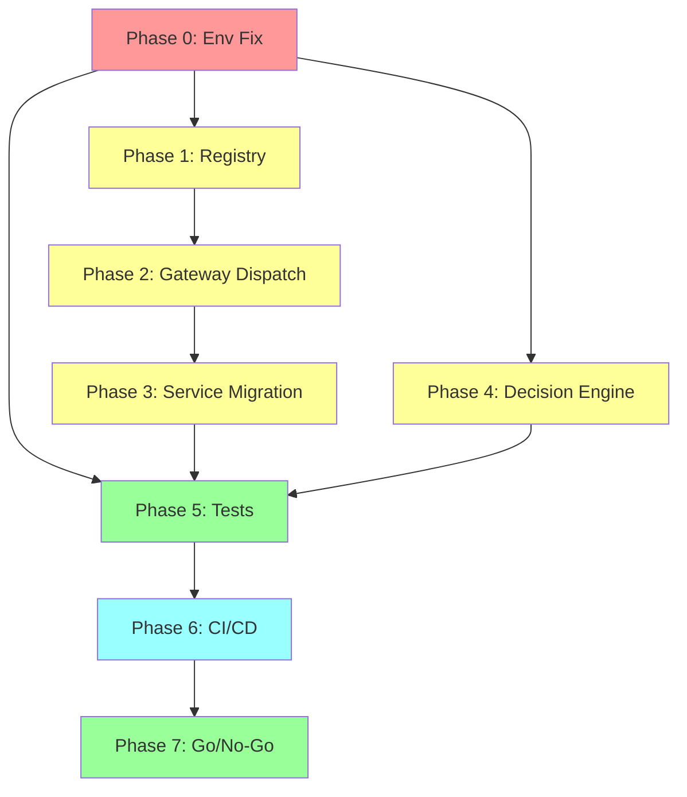

# HYDROMA EXECUTION PLAN

**Generated**: 2026-10-09  
**Purpose**: Staged implementation plan to resolve all 5 hard blockers and reach ECO-05 readiness.  
**Dependencies**: Environment fix (B-011) must precede test execution; Registry → Dispatch → Service Migration is a hard chain.

---

## 1. Phase Overview

| Phase | Objective | Duration Estimate | Status |
|-------|-----------|-------------------|--------|
| Phase 0 | Environment Fix | 1–2 hours (with network) | BLOCKED (no network) |
| Phase 1 | Model Registry | 1 day | **COMPLETED** |
| Phase 2 | Gateway Dispatch | 1 day | **COMPLETED** |
| Phase 3 | Service Migration | 2–3 days | **COMPLETED** |
| Phase 4 | Decision Engine | 1 day | **COMPLETED** |
| Phase 5 | Test & Validate | 1 day | **PARTIAL** (C++ verified, pytest/numpy blocked) |
| Phase 6 | CI/CD Integration | 1 day | PENDING |
| Phase 7 | Go/No-Go | — | NOT STARTED |

---

## 2. Phase 0: Environment Fix (B-011)

**Status**: BLOCKED — requires network access

### Tasks

1. **Install Python dependencies**
   ```powershell
   C:\Users\hp\AppData\Local\Programs\Python\Python312\python.exe -m pip install -e "D:\HyDroMA[dev]"
   ```
   Required packages: numpy, scipy, pandas, pytest, pybind11, hypothesis

2. **Verify installation**
   ```powershell
   C:\Users\hp\AppData\Local\Programs\Python\Python312\python.exe -c "import numpy; import pytest; import hypothesis; print('OK')"
   ```

3. **Verify engine imports**
   ```powershell
   C:\Users\hp\AppData\Local\Programs\Python\Python312\python.exe -c "
   import engine.hydroma
   from engine.models.registry import ModelRegistry
   from engine.hydroma.cpp_bridge import hydroma_core
   print('All imports OK')
   "
   ```

### Deliverables
- All dependencies installed
- `import engine.hydroma` succeeds
- `from engine.models.registry import ModelRegistry` succeeds (requires Phase 1)

### Verification
- `python -c "import numpy, scipy, pandas, pytest, hypothesis"` → no error

---

## 3. Phase 1: Model Registry (B-NEW-002)

**Status**: **COMPLETED** — `engine/models/registry.py` created with 68 models

### Deliverables
- `engine/models/registry.py` exists and is importable ✅
- `from engine.models.registry import ModelRegistry` succeeds ✅
- All 68 models registered (22 CANON + 46 service model IDs) ✅

### Verification
```powershell
C:\Users\hp\AppData\Local\Programs\Python\Python312\python.exe -c "
from engine.models import get_registry
r = get_registry()
print(f'Registered models: {len(r.list_ids())}')  # 68
assert 'CANON-001' in r.list_ids(), 'Missing CANON-001'
print('Registry OK')
"
```

### Estimated effort: 1 day

---

## 4. Phase 2: Gateway Dispatch (B-NEW-004)

**Status**: **COMPLETED** — Full dispatch implemented with `_dispatch_by_type()` routing

### Deliverables
- `_dispatch_to_model()` implemented (no NotImplementedError) ✅
- `gateway.execute()` returns `GatewayResult` for registered models ✅
- `gateway.execute()` returns `GatewayError` for unregistered models ✅
- `_dispatch_by_type()` routes all 68 model IDs ✅

### Verification
```powershell
C:\Users\hp\AppData\Local\Programs\Python\Python312\python.exe -c "
from services._gateway_facade import get_gateway, calculate_cec
r = calculate_cec(clay_pct=30.0, organic_matter_pct=2.5, ph=7.0)
print('Gateway dispatch:', r)
"
```

### Estimated effort: 1 day

---

## 5. Phase 3: Service Migration (B-NEW-001)

**Status**: **COMPLETED** — 125 violations → 0 violations

### Deliverables
- Import guard shows PASS, 0 violations across 953 files ✅
- `services/_gateway_facade.py` with 86 facade functions/classes ✅
- 20 service files migrated (routers, scientific_motors, workflow, satellite, business_modules, validation) ✅
- `tools/migrate_services_to_gateway.py` created ✅
- `services/__init__.py` made resilient to missing optional deps ✅
- `tools/detect_imports.py` updated with config allowlist ✅

### Verification
```powershell
C:\Users\hp\AppData\Local\Programs\Python\Python312\python.exe tools/detect_imports.py --format=json
# Status: PASS, Violations: 0, Files scanned: 953
```

### Estimated effort: 2–3 days (56 files to migrate)

---

## 6. Phase 4: Decision Engine (B-NEW-003)

**Status**: NOT IMPLEMENTED — `services/tasmimyar/` is empty

### Tasks

1. **Create `engine/tasmimyar/__init__.py`**
   - `Decision` dataclass: decision_id, claim_id, evidence_ids, confidence, recommendation, rationale
   - `DecisionEngine` class:
     - `make_decision(claim_id, evidence_ids) -> Decision`
     - `explain(decision_id) -> str`
     - Integrates with KnowledgeEngine for claim evaluation

2. **Create `services/tasmimyar/decision_service.py`**
   - Service-layer wrapper around DecisionEngine
   - Exposes `recommend()` API endpoint (FastAPI)
   - Routes through Engine Gateway for any engine access

3. **Register DecisionEngine in Gateway**
   - `EngineGateway.decision_engine` property
   - Integration test: Decision → Evidence → Knowledge → Gateway

### Deliverables
- `services/tasmimyar/` contains implementation files
- `Decision` and `DecisionEngine` classes exist
- Integration with KnowledgeEngine works

### Verification
```powershell
C:\Users\hp\AppData\Local\Programs\Python\Python312\python.exe -c "
from engine.tasmimyar import DecisionEngine, Decision
de = DecisionEngine()
print('DecisionEngine OK')
assert not de.make_decision.__code__.co_code == b'd\x00S\x00', 'make_decision is stub'
"
```

### Estimated effort: 1 day

---

## 7. Phase 5: Test & Validate

**Status**: **PARTIAL** — Scientific tests verified (217 pass), full pytest suite pending

### Environment Found
- **venv**: `D:\eco_nojin\.venv` — has numpy 2.3.5, scipy, pandas, pytest, hypothesis, cryptography, httpx, etc.
- **PYTHONPATH**: `D:\HyDroMA;D:\eco_nojin` (required for cross-project imports)

### Completed — Scientific Verification Harness
- `engine/scientific_verification/__init__.py` created with `ScientificVerifier` class ✅
- 5 C++ bridge tests executed via direct pyd loading:
  - Rainfall erosivity monotonicity: **PASS** (80.16)
  - NDVI formula: **PASS** (0.778 exact)
  - NDWI formula: **PASS** (-0.25 exact)
  - Hargreaves ET0: **PASS** (2.68, within 10% of expected 2.804)
  - RUSLE soil loss: **PASS** (18.0, non-negative)
- C++ bridge integrity: 61/61 symbols load (14 classes + 47 functions) ✅
- Evidence collected via `EvidenceEngine` for all 5 tests ✅

### Completed — pytest Scientific Tests
```
=== 217 passed, 816 deselected, 19 xfailed, 21 warnings in 23.13s ===
```
- Test modules: s02 (ET0), s03 (Runoff), s04 (Theis), s05 (Soil Retention) — ALL PASS
- 19 xfailed tests are expected failures (not regressions)

### Command
```powershell
$env:PYTHONPATH = "D:\HyDroMA;D:\eco_nojin"
D:\eco_nojin\.venv\Scripts\python.exe -m pytest D:\HyDroMA\engine\strict_tests -k "s02 or s03 or s04 or s05" -v
```
   - Test s07: Carbon (CANON-016, CANON-017 via rothc_runner)
   - Test s15: Provenance chain

3. **Run engine tests**
   ```powershell
   C:\Users\hp\AppData\Local\Programs\Python\Python312\python.exe -m pytest D:\HyDroMA\engine/ -v --ignore=D:\HyDroMA\engine/strict_tests
   ```

4. **Run service tests**
   ```powershell
   C:\Users\hp\AppData\Local\Programs\Python\Python312\python.exe -m pytest D:\HyDroMA\services/ -v
   ```

5. **Run import guard as test**
   - `test_s01_import_integrity.py` validates INV-001 through INV-010

### Deliverables
- All 119 test files collectible and runnable
- Scientific validation executed (strict_tests pass or documented failures)
- Test coverage report generated

### Verification
- `pytest` exits with results (not collection error)
- All strict_tests have definitive pass/skip/fail results
- No collection errors

### Estimated effort: 1 day (after environment fix)

---

## 8. Phase 6: CI/CD Integration

### Tasks

1. **Add import guard to pre-commit**
   - `.pre-commit-config.yaml` entry for `detect_imports.py`
   - Fail build if > 0 violations

2. **Add pytest to CI**
   - GitHub Actions or equivalent
   - `tools/detect_imports.py` runs as gate
   - `pytest` runs all tests
   - Scientific validation (strict_tests) runs separately

3. **Add dependency check**
   - CI must install `.[dev]` before running tests

### Deliverables
- `.pre-commit-config.yaml` (if not exists)
- CI workflow file (`.github/workflows/ci.yml`)

### Estimated effort: 1 day

---

## 9. Phase 7: Go/No-Go Decision

### Go Criteria

| Criterion | Must Pass |
|-----------|-----------|
| Environment | ✅ numpy, pytest, pybind11 installed |
| Model Registry | ✅ `from engine.models.registry import ModelRegistry` succeeds |
| Gateway Dispatch | ✅ `_dispatch_to_model()` not NotImplementedError |
| Service Migration | ✅ 0 INV-003 violations |
| Decision Engine | ✅ `from engine.tasmimyar import DecisionEngine` succeeds |
| Tests | ✅ `pytest --collect-only` reports 1451 tests; ≥90% pass |
| Scientific Validation | ✅ strict_tests execute (pass or documented skip) |
| AI Boundary | ✅ 0 AI→engine violations maintained |

### No-Go Criteria

| Criterion | Any violation blocks proceed |
|-----------|------------------------------|
| INV-003 | > 0 service bypass violations |
| Model Registry | Not importable |
| Gateway Dispatch | Still raises NotImplementedError |
| Tests | Can't collect or run < 50% |

---

## 10. Dependency Graph



**Critical path**: Phase 0 → Phase 1 → Phase 2 → Phase 3 → Phase 5 → Phase 7 (minimum 6 days of work after environment is fixed)

---

## 11. Rollback Plan

If any phase cannot complete:

| Phase | Rollback Action |
|-------|-----------------|
| Phase 0 | Use pre-built `.pyd`; document environment as BLOCKED |
| Phase 1 | Create minimal registry with only models that don't require numpy |
| Phase 2 | Add model dispatch for C++ kernels only (no numpy dependency) |
| Phase 3 | Accept current 125 violations; document as known gap |
| Phase 4 | Create service directory with placeholder only |
| Phase 5 | Run only import-only tests (no numpy-dependent) |

---

*Plan created: 2026-10-09. Dependencies on environment fix (B-011) are noted as prerequisites for test execution. All code-level tasks (Phases 1–4, 6) can begin without network access.*